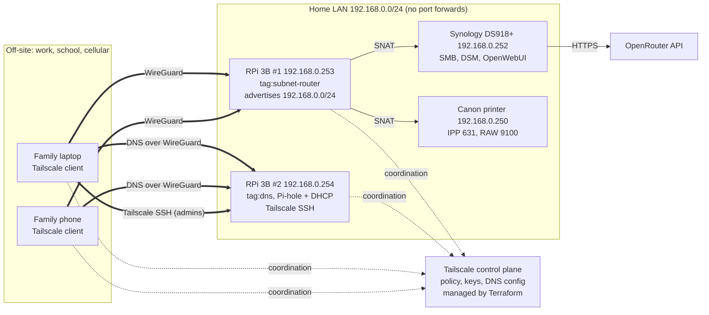

# Family Remote Access with Tailscale

Family remote access with a Tailscale subnet router, Tailscale SSH, and tailnet-wide Pi-hole DNS. One Raspberry Pi routes the home LAN into the tailnet so the printer and NAS are reachable from anywhere, a second Raspberry Pi runs Pi-hole for every device on the tailnet and accepts keyless Tailscale SSH for emergency repairs, and the entire tailnet posture (identities, tags, ACLs, SSH rules, route approval, DNS) is managed by Terraform with policy tests. Nothing on the home router is port-forwarded.

## Tailnet used for this exercise

`<tailnet-name>.ts.net`

## The customer and the problem

The customer is my family: a few laptops and phones that leave the house every day, and a home network with devices that cannot run a VPN client.

| # | Pain point | Solution in this deployment |
|---|---|---|
| 1 | Print to the home Canon printer from work, school, or cellular without port forwarding or printer software | Subnet router exposes `192.168.0.250` to authorized tailnet members; ACL limits access to print ports |
| 2 | Emergency admin access to the Pi-hole DNS server without managing SSH keys or exposing port 22 | Tailscale SSH on the Pi-hole node with `check` mode (identity plus periodic browser re-auth) |
| 3 | Remote access to Synology NAS files and media without port forwarding | Subnet route to `192.168.0.252`; ACL allows SMB and DSM ports only |
| 4 | Ad and tracker blocking for phones and laptops away from home | Tailnet global DNS points to Pi-hole with "Override local DNS" enabled; MagicDNS on |
| 5 | (Stretch) Private access to OpenWebUI on the NAS, backed by OpenRouter | Docker Compose stack on the NAS, reachable only via the subnet route |

## Why I chose this approach

- **Option (a) matches the household's real, daily problems.** The printer cannot run a Tailscale client and the NAS is simpler to leave untouched, so a subnet router is the natural way to reach them. Tailscale SSH solves the "how do I fix DNS from my phone" problem without SSH keys or an open port.
- **Separate failure domains.** A dedicated router Pi keeps routing independent of DNS, so either Pi can be rebooted without taking the other service down.
- **An out-of-band path to fix DNS when DNS is what broke.** DNS is the service most likely to take the household "offline": devices stay connected, but nothing resolves. Tailscale SSH runs directly on the Pi-hole node, so the rescue path does not depend on the broken service:
  - The node is reached by its tailnet address over WireGuard, not through the subnet route, so it works even if the router Pi is down.
  - Tailnet hostnames such as `rpi-pihole` are answered locally by the client's MagicDNS resolver, not by Pi-hole, so `tailscale ssh root@rpi-pihole` still resolves while Pi-hole is broken.
  - The Pi-hole node runs with `--accept-dns=false`, so its own upstream lookups never loop back through the tailnet.
- **Infrastructure as code.** Groups, tags, ACLs, SSH rules, route auto-approval and DNS all live in Terraform. Policy tests in the tailnet policy make the control plane reject any future change that breaks expected access.

## Architecture



| Device | LAN IP | Runs Tailscale? | Role | Tailscale identity |
|---|---|---|---|---|
| Raspberry Pi 3B #1 | `192.168.0.253` | Yes | Dedicated subnet router advertising `192.168.0.0/24` | `tag:subnet-router`, hostname `rpi-subnet-router` |
| Raspberry Pi 3B #2 | `192.168.0.254` | Yes | Pi-hole DNS, LAN DHCP, Tailscale SSH target | `tag:dns`, hostname `rpi-pihole` |
| Synology DS918+ | `192.168.0.252` | No (reached via subnet route) | Storage plus Docker host (OpenWebUI) | n/a |
| Canon printer | `192.168.0.250` | No (cannot) | Printing endpoint | n/a |

## Security model

| Who | Can reach | Ports |
|---|---|---|
| `group:admins` | Entire home LAN, both Pis | All |
| `group:admins` | `tag:dns` via Tailscale SSH | SSH as `root` or any non-root user, `check` mode |
| `group:family` | Printer `192.168.0.250` | TCP 631 (IPP), 9100 (RAW), 515 (LPD) |
| `group:family` | NAS `192.168.0.252` | TCP 445 (SMB), 5000/5001 (DSM), 3000 (OpenWebUI) |
| Every member | Pi-hole (tailnet and LAN address) | 53 TCP/UDP |
| Every member | Their own devices | All |

- **Tags and `tagOwners`.** Both Pis authenticate as tagged devices (`tag:subnet-router`, `tag:dns`), so they are owned by the tailnet rather than by a person, and their node keys do not expire. Only `group:admins` can apply these tags.
- **`autoApprovers`.** Routes for `192.168.0.0/24` are approved automatically, but only when advertised by a `tag:subnet-router` device. Since only admins can apply that tag, a family member cannot advertise a route that gets trusted.
- **Tailscale SSH in `check` mode.** No SSH keys to distribute or rotate. Admins must re-authenticate in the browser every 12 hours before a new session is allowed.
- **Single-use, short-lived bootstrap keys.** Terraform mints one pre-authorized, tagged, single-use auth key per Pi that expires in one hour. The keys are never written to disk on the Pis.
- **Policy tests.** The `tests` block asserts that family members can print, reach SMB and DNS, and cannot SSH to the Pi-hole or NAS. The control plane rejects any policy that breaks these.
- **No exposure to the internet.** Nothing on the home router is port-forwarded; every inbound path is a WireGuard tunnel authorized by the tailnet policy.

## Repository layout

```
.
├── README.md
├── docker/
│   ├── .env.example            # template; real .env lives only on the NAS
│   └── docker-compose.yml      # OpenWebUI backed by OpenRouter
├── scripts/
│   ├── setup_pihole_ssh_node.sh  # RPi #2: Tailscale SSH + Pi-hole listening mode
│   └── setup_subnet_router.sh    # RPi #1: IP forwarding + advertise LAN route
└── terraform/
    ├── .terraform.lock.hcl     # provider checksums
    ├── main.tf                 # policy, auth keys, route pinning, DNS
    ├── outputs.tf
    ├── policy.hujson           # tailnet policy template (identities injected)
    ├── providers.tf
    ├── terraform.tfvars.example
    └── variables.tf
```

## Deploy it yourself

### Prerequisites

- Terraform 1.6 or later, `bash`, `ssh`, and optionally `shellcheck`.
- A Tailscale account with at least one admin and one family member in the tailnet.
- A Tailscale API access token created by the admin (admin console, Settings, Keys), exported in your shell:
  ```bash
  export TAILSCALE_API_KEY=<token>
  ```
- Two Raspberry Pis running Raspberry Pi OS Lite (Bookworm or later), with Pi-hole installed on the second one, and SSH access as a user with sudo.

### Why Terraform runs in two stages

A fresh tailnet cannot be configured in one pass:

1. The Pis need tagged auth keys, and those tags must exist in `tagOwners` before the keys can be created.
2. `autoApprovers` must be in the policy before the router Pi advertises its route, or the route waits for manual approval.
3. Pointing tailnet DNS at Pi-hole before Pi-hole is on the tailnet would break DNS for every device.

A single variable, `bootstrap_complete`, controls this.

| Stage | `bootstrap_complete` | What it manages |
|---|---|---|
| 1 | `false` | Policy (groups, tags, ACLs, SSH, autoApprovers, tests), MagicDNS, two single-use tagged auth keys |
| 2 | `true` | Looks up both Pis, pins the approved subnet route, sets Pi-hole as global nameserver with "Override local DNS" |

### Stage 1: policy and auth keys

```bash
cp terraform/terraform.tfvars.example terraform/terraform.tfvars   # fill in real identities
terraform -chdir=terraform init
terraform -chdir=terraform plan -out=stage1.tfplan
terraform -chdir=terraform apply stage1.tfplan
```

`tailscale_acl` uses `overwrite_existing_content = true`, which replaces the current tailnet policy. Back up any custom policy first.

### Configure the Raspberry Pis

```bash
scp scripts/setup_subnet_router.sh   <user>@192.168.0.253:~/
scp scripts/setup_pihole_ssh_node.sh <user>@192.168.0.254:~/

terraform -chdir=terraform output -raw subnet_router_auth_key   # copy, then paste at the prompt
ssh -t <user>@192.168.0.253 'sudo bash ~/setup_subnet_router.sh'

terraform -chdir=terraform output -raw pihole_auth_key          # copy, then paste at the prompt
ssh -t <user>@192.168.0.254 'sudo bash ~/setup_pihole_ssh_node.sh'
```

The scripts are idempotent and read the key from `TS_AUTHKEY` or a hidden prompt, so it never touches disk. Keys are single-use and expire after one hour.

### Stage 2: route pinning and DNS

Set `bootstrap_complete = true` in `terraform/terraform.tfvars`, then:

```bash
terraform -chdir=terraform plan -out=stage2.tfplan
terraform -chdir=terraform apply stage2.tfplan
terraform -chdir=terraform output pihole_tailscale_ipv4 global_nameserver
```

### OpenWebUI on the NAS (optional)

```bash
# On the NAS, in /volume1/docker/open-webui
cp .env.example .env   # set OPENROUTER_API_KEY and WEBUI_SECRET_KEY (openssl rand -hex 32)
docker compose up -d
```

Or import `docker-compose.yml` as a Project in Synology Container Manager.

- If the DSM firewall is enabled, allow the subnet router's LAN IP `192.168.0.253`. Linux subnet routers SNAT by default, so remote traffic arrives at the NAS and printer from `.253`. This also means no static return route is needed on the ISP router.
- After creating the first admin account in OpenWebUI, set `ENABLE_SIGNUP=false` and redeploy.

## Verification

All tests run from a laptop on a phone hotspot, off the home network. Testing from inside the LAN proves nothing.

| Test | Command | Expected | Result |
|---|---|---|---|
| Router reachable | `tailscale ping rpi-subnet-router` | pong | _pending_ |
| Printer port | `nc -vz 192.168.0.250 631` | succeeded | _pending_ |
| NAS SMB | `nc -vz 192.168.0.252 445` | succeeded | _pending_ |
| NAS DSM | `curl -skI https://192.168.0.252:5001` | HTTP response | _pending_ |
| OpenWebUI | `curl -sI http://192.168.0.252:3000` | HTTP 200 | _pending_ |
| DNS resolution | `dig @<pihole-100.x> example.com +short` | an IP | _pending_ |
| Ad blocking | `dig doubleclick.net +short` | `0.0.0.0` or empty | _pending_ |
| Pi-hole log | Pi-hole query log | queries from 100.x clients | _pending_ |
| Tailscale SSH | `tailscale ssh root@rpi-pihole` | browser check, then shell, no keys | _pending_ |
| Out-of-band admin | `sudo systemctl restart pihole-FTL` in that session | service restarts | _pending_ |
| Negative test | family account: SSH, or `nc -vz 192.168.0.252 22` | denied | _pending_ |
| Remote print | Add printer by IP (`192.168.0.250`, IPP), print test page | page prints | _pending_ |

## Troubleshooting runbook (subnet routers)

| Check | Command | What it proves |
|---|---|---|
| Node online, path type | `tailscale status`, `tailscale ping rpi-subnet-router` | Router is connected; whether the path is direct or relayed via DERP |
| NAT and UDP | `tailscale netcheck` | NAT type, UDP reachability, nearest DERP region |
| Forwarding on the router | `sysctl net.ipv4.ip_forward` | Must be `1`, or packets are dropped at the Pi |
| Route advertised | `tailscale debug prefs` on the router | `AdvertiseRoutes` contains `192.168.0.0/24` |
| Route approved | Admin console, Machines, router, Subnets | Route shows approved (auto-approved via tag) |
| Linux clients | `tailscale set --accept-routes=true` | Linux does not accept subnet routes by default |
| Overlapping subnets | `route get 192.168.0.250` (macOS), `ip route get 192.168.0.250` (Linux) | If the remote network is also `192.168.0.0/24`, the local route can win |
| ACL denies | Admin console "Preview rules", policy `tests` | Whether the user is allowed to that host and port |
| Endpoint firewall | DSM firewall, printer "local subnet only" settings | SNAT presents traffic as `192.168.0.253`; allow it |
| DNS | `dig @<pihole-100.x> example.com` | If it times out, check Pi-hole listening mode; confirm "Override local DNS" is on |
| Printer discovery | n/a | Bonjour/mDNS does not traverse the subnet route; add the printer manually by IP using IPP |

## Design trade-offs

- **Subnet router vs Tailscale on the NAS.** The printer cannot run a client, so a subnet router is needed anyway. Routing the NAS through it keeps one pattern and leaves DSM untouched. The cost is coarser identity: the NAS sees every remote user as `192.168.0.253`. Running Tailscale on the NAS would give per-device identity and is listed under future work.
- **Tailscale IP vs LAN IP for global DNS.** The default is Pi-hole's own tailnet address (`dns_nameserver_mode = "tailscale"`); the LAN address `192.168.0.254` is supported with `"lan"`. The tailnet address is a direct WireGuard peer, so DNS does not also depend on the subnet router. It never collides with hotel, school or office networks that also use `192.168.0.0/24`. It also works on Linux clients that have not enabled `--accept-routes`.
- **`check` vs `accept` for SSH.** `check` adds a browser re-authentication every 12 hours. For a node that controls household DNS, the small friction is worth the protection against a stolen, unlocked laptop.
- **SNAT on vs off.** Left on (the Linux default). Endpoints see traffic from the router's LAN IP, so no return route is needed on the ISP router, at the cost of losing the original tailnet source address in NAS and printer logs.
- **`acls` vs `grants`.** The policy uses the established `acls` syntax, which maps one to one to the table above. `grants` is the newer, more expressive model and is listed as future work.
- **API token vs OAuth client.** An admin API access token inherits tag ownership, so it can mint tagged auth keys on the first apply without a bootstrap problem. A scoped OAuth client driven from CI is the better long-term answer.

## What I would change with more time

- Enable Tailnet Lock so new nodes must be signed by trusted keys held on admin devices. That way a compromised control plane or a leaked auth key alone cannot add a node. With Tailnet Lock enabled, the Terraform-issued bootstrap keys would need to be pre-signed (`tailscale lock sign`), which is a workflow change worth documenting.
- Replace the API token with a scoped OAuth client and run `terraform plan` / `apply` from GitHub Actions (GitOps for the policy), with remote state.
- Migrate `acls` to the newer `grants` syntax and add `sshTests`.
- High availability: a second subnet router advertising the same route for failover.
- Renumber the home LAN to a less common range (or use 4via6) to avoid overlap with hotel and office networks.
- AirPrint for iPhones: a CUPS/Avahi print gateway, or expose the printer as a Tailscale service so it is discoverable.
- Run Tailscale directly on the NAS for per-device identity and exit-node use, and put OpenWebUI behind Tailscale Serve with HTTPS and a MagicDNS name.
- Ansible or cloud-init for the Pi configuration instead of shell scripts; persist the UDP GRO setting.
- Monitoring: Tailscale network flow logs, Pi-hole metrics, alerting when a node goes offline.
