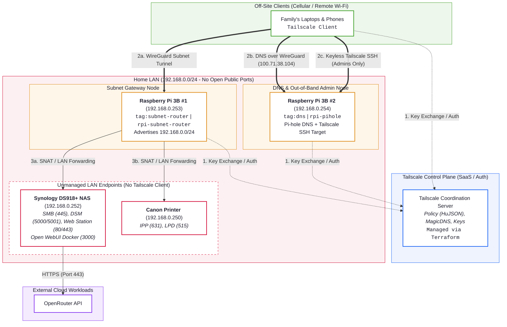

# Family Remote Access with Tailscale

**Implementation scenario:** A subnet router and a Tailscale device with Tailscale SSH enabled.

Family remote access with a Tailscale subnet router, Tailscale SSH, and tailnet-wide Pi-hole DNS for ads and tracker blocking. One Raspberry Pi routes the home LAN into the tailnet so the printer and NAS are reachable from anywhere, a second Raspberry Pi runs Pi-hole for every device on the tailnet and accepts keyless Tailscale SSH for emergency repairs, and the entire tailnet posture (identities, tags, ACLs, SSH rules, route approval, DNS) is managed by Terraform with policy tests. With this set up there's no port forwarding required on the home router.

## Tailnet used for this exercise

`tail3eb5b2.ts.net`

## The customer and the problem

The customer is my family: a few laptops and phones that leave the house every day, and a home network with devices that cannot run a VPN client.

| # | Pain point | Solution in this deployment |
|---|---|---|
| 1 | Print to the home Canon printer from work, school, or cellular without port forwarding or printer software | Subnet router exposes `192.168.0.250` to authorized tailnet members; ACL limits access only to print ports |
| 2 | Emergency admin access to the Pi-hole DNS server without managing SSH keys or exposing port 22 | Tailscale SSH on the Pi-hole node with `check` mode (identity plus periodic browser re-auth) |
| 3 | Remote access to Synology NAS files and media without port forwarding | Subnet route to `192.168.0.252`; ACL allows only the NAS services the family uses (SMB, DSM, Web Station) |
| 4 | Ad and tracker blocking for phones and laptops away from home | Tailnet global DNS points to Pi-hole with "Override local DNS" enabled; MagicDNS on |
| 5 | Private access to Open WebUI on the NAS, backed by OpenRouter | Open WebUI container runs on the NAS and uses an OpenRouter API key to provide private and cheap access to LLMs, reachable only via the subnet route |

## Why I chose this approach

- **A subnet router and a Tailscale device with Tailscale SSH enabled solves the household's real, daily problems.** The printer cannot run a Tailscale client and the NAS is simpler to leave untouched, so a subnet router is the natural way to reach them. Tailscale SSH solves the "how do I fix DNS from my phone" problem without SSH keys or an open port.
- **Separate failure domains.** A dedicated router Raspberry Pi keeps routing independent of DNS, so either Raspberry Pi can be rebooted without taking the other service down.
- **An out-of-band path to fix DNS when DNS is what broke.** DNS is the service most likely to take the household "offline", i.e. devices stay connected, but nothing resolves. Tailscale SSH runs directly on the Pi-hole node, so the rescue path does not depend on the broken service:
  - The node is reached by its tailnet address over WireGuard, not through the subnet route, so it works even if the router Raspberry Pi is down.
  - Tailnet hostnames such as `rpi-pihole` are answered locally by the client's MagicDNS resolver, not by Pi-hole, so `tailscale ssh root@rpi-pihole` still resolves while Pi-hole is broken.
  - The Pi-hole node runs with `--accept-dns=false`, so its own upstream lookups never loop back through the tailnet.
- **DNS on Pi-hole's Tailscale address.** Tailnet DNS points at Pi-hole's Tailscale address rather than its LAN address, so DNS still works on networks that also use 192.168.0.x and does not depend on the subnet router.
- **Infrastructure as code.** Groups, tags, ACLs, SSH rules, route auto-approval and DNS all live in Terraform. Policy tests in the tailnet policy make the control plane reject any future change that breaks expected access.

## Architecture



| Device | LAN IP | Runs Tailscale? | Role | Tailscale identity |
|---|---|---|---|---|
| Raspberry Pi 3B #1 | `192.168.0.253` | Yes | Dedicated subnet router advertising `192.168.0.0/24` | `tag:subnet-router`, hostname `rpi-subnet-router` |
| Raspberry Pi 3B #2 | `192.168.0.254` | Yes | Pi-hole DNS, LAN DHCP, Tailscale SSH target | `tag:dns`, hostname `rpi-pihole` |
| Synology DS918+ | `192.168.0.252` | No (reached via subnet route) | Storage plus Docker host (Open WebUI) | n/a |
| Canon printer | `192.168.0.250` | No (cannot) | Printing endpoint | n/a |

## Security model

| Who | Can reach | Ports |
|---|---|---|
| `group:admins` | Entire home LAN, both Raspberry Pis | All |
| `group:admins` | `tag:dns` via Tailscale SSH | SSH as `root` or any non-root user, `check` mode |
| `group:family` | Printer `192.168.0.250` | TCP 631 (IPP), 515 (LPD) |
| `group:family` | NAS `192.168.0.252` | TCP 445 (SMB), 5000/5001 (DSM, File Station, Synology mobile apps), 80/443 (Web Station, reverse proxy), 3000 (Open WebUI) |
| Every member | Pi-hole (tailnet and LAN address) | 53 TCP/UDP |
| Every member | Their own devices | All |

- **Tags and `tagOwners`.** Both Raspberry Pis authenticate as tagged devices (`tag:subnet-router`, `tag:dns`), so they are owned by the tailnet rather than by a person, and their node keys do not expire. Only `group:admins` can apply these tags.
- **`autoApprovers`.** Routes for `192.168.0.0/24` are approved automatically, but only when advertised by a `tag:subnet-router` device. Since only admins can apply that tag, a family member cannot advertise a route that gets trusted.
- **Tailscale SSH in `check` mode.** No SSH keys to distribute or rotate. Admins must re-authenticate in the browser every 12 hours before a new session is allowed.
- **Single-use, short-lived bootstrap keys.** Terraform mints one pre-authorized, tagged, single-use auth key per Raspberry Pi that expires in one hour. The keys are never written to disk on the Raspberry Pis.
- **Policy tests.** The `tests` block asserts that family members can print, reach SMB and DNS, and cannot SSH to the Pi-hole or NAS. The control plane rejects any policy that breaks these.
- **No exposure to the internet.** Nothing on the home router is port-forwarded; every inbound path is a WireGuard tunnel authorized by the tailnet policy.

## Repository layout

```
.
├── README.md
├── docker/
│   ├── .env.example            # template; real .env lives only on the NAS
│   └── docker-compose.yml      # Open WebUI backed by OpenRouter
├── scripts/
│   ├── setup_pihole_ssh_node.sh  # Raspberry Pi #2: Tailscale SSH + Pi-hole listening mode
│   └── setup_subnet_router.sh    # Raspberry Pi #1: IP forwarding + advertise LAN route
└── terraform/
    ├── .terraform.lock.hcl     # provider checksums
    ├── main.tf                 # policy, auth keys, route pinning, DNS
    ├── outputs.tf
    ├── policy.hujson           # tailnet policy template (identities injected)
    ├── providers.tf
    ├── terraform.tfvars.example
    └── variables.tf
```

## Deployment instructions

### Prerequisites

- Terraform 1.6 or later, `bash`, `ssh`, and optionally `shellcheck`.
- A Tailscale account with at least one admin and one family member in the tailnet.
- A Tailscale API access token created by the admin (admin console, Settings, Keys), exported in your shell:
  ```bash
  export TAILSCALE_API_KEY=<token>
  ```
- Two Raspberry Pis running Raspberry Pi OS Lite (Trixie - Debian 13), with Pi-hole installed on the second one, and SSH access as a user with sudo.

### Why Terraform runs in two stages

A fresh tailnet cannot be configured in one pass:

1. The Raspberry Pis need tagged auth keys, and those tags must exist in `tagOwners` before the keys can be created.
2. `autoApprovers` must be in the policy before the router Raspberry Pi advertises its route, or the route waits for manual approval.
3. Pointing tailnet DNS at Pi-hole before Pi-hole is on the tailnet would break DNS for every device.

A single variable, `bootstrap_complete`, controls this.

| Stage | `bootstrap_complete` | What it manages |
|---|---|---|
| 1 | `false` | Policy (groups, tags, ACLs, SSH, autoApprovers, tests), MagicDNS, two single-use tagged auth keys |
| 2 | `true` | Looks up both Raspberry Pis, pins the approved subnet route, sets Pi-hole as global nameserver with "Override local DNS" |

### Stage 1: policy and auth keys

```bash
cp terraform/terraform.tfvars.example terraform/terraform.tfvars   # fill in real identities
terraform -chdir=terraform init
terraform -chdir=terraform plan -out=stage1.tfplan
terraform -chdir=terraform apply stage1.tfplan
```

`tailscale_acl` uses `overwrite_existing_content = true`, which replaces the current tailnet policy. Back up any custom policy first.

### Configure the Raspberry Pis

```bash
scp scripts/setup_subnet_router.sh   <user>@192.168.0.253:~/
scp scripts/setup_pihole_ssh_node.sh <user>@192.168.0.254:~/

terraform -chdir=terraform output -raw subnet_router_auth_key   # copy, then paste at the prompt
ssh -t <user>@192.168.0.253 'sudo bash ~/setup_subnet_router.sh'

terraform -chdir=terraform output -raw pihole_auth_key          # copy, then paste at the prompt
ssh -t <user>@192.168.0.254 'sudo bash ~/setup_pihole_ssh_node.sh'
```

The scripts are idempotent and read the key from `TS_AUTHKEY` or a hidden prompt, so it never touches disk. Keys are single-use and expire one hour after the stage 1 apply. If a key expires, regenerate a replacement with `terraform -chdir=terraform apply -replace=tailscale_tailnet_key.<name>`.

### Stage 2: route pinning and DNS

Set `bootstrap_complete = true` in `terraform/terraform.tfvars`, then:

```bash
terraform -chdir=terraform plan -out=stage2.tfplan
terraform -chdir=terraform apply stage2.tfplan
terraform -chdir=terraform output pihole_tailscale_ipv4 global_nameserver
```

### Open WebUI on the NAS

```bash
# On the NAS, in /volume1/docker/open-webui
cp .env.example .env   # set OPENROUTER_API_KEY and WEBUI_SECRET_KEY (openssl rand -hex 32)
sudo docker-compose up -d   # DSM 7.1 Docker package
```

- If the DSM firewall is enabled, allow the subnet router's LAN IP `192.168.0.253`. Linux subnet routers SNAT by default, so remote traffic arrives at the NAS and printer from `.253`. This also means no static return route is needed on the ISP router.
- The first account created in Open WebUI becomes the admin. After that, turn off **New Sign Ups** in Admin Panel, Settings, Authentication. `ENABLE_SIGNUP` in `.env` only applies on the first start; after that the setting is stored in Open WebUI's database.

## Verification

Tests were run from a MacBook tethered to an Android phone hotspot (`10.175.227.167`, cellular), off the home network, signed in as an admin. This was performed to replicate a real-world scenario because testing from inside the LAN would not prove anything. The Mac's route to `192.168.0.250` was confirmed to go through the Tailscale interface (`utun4`).

| Test | Command | Expected | Result |
|---|---|---|---|
| Router reachable | `tailscale ping rpi-subnet-router` | pong | ✅ pong via DERP (Toronto), 510 ms |
| Pi-hole node reachable | `tailscale ping rpi-pihole` | pong | ✅ pong via DERP (Toronto), 283 ms |
| Printer IPP | `nc -vz 192.168.0.250 631` | succeeded | ✅ |
| NAS SMB | `nc -vz 192.168.0.252 445` | succeeded | ✅ |
| NAS DSM | `curl -skI https://192.168.0.252:5001` | HTTP response | ✅ HTTP 200 |
| NAS HTTPS (Web Station) | `nc -vz 192.168.0.252 443` | succeeded | ✅ |
| Open WebUI | `http://192.168.0.252:3000` in a browser, send a chat message | reply from an OpenRouter model | ✅ logged in and got a reply (Qwen via OpenRouter); sign ups disabled |
| DNS resolution | `dig @100.71.38.104 example.com +short` | an IP | ✅ `104.20.23.154` |
| Ad blocking | system resolver lookup of `doubleclick.net` | `0.0.0.0` or empty | ✅ `0.0.0.0` |
| MagicDNS | system resolver lookup of `rpi-pihole` | tailnet IP | ✅ `100.71.38.104` |
| Pi-hole log | Pi-hole query log | queries from 100.x clients | ✅ queries from the Mac's tailnet IP |
| Tailscale SSH | `tailscale ssh pi@rpi-pihole` | browser check, then shell, no keys | ✅ |
| Out-of-band admin | `sudo systemctl restart pihole-FTL` in that session | service restarts | ✅ |
| Route auto-approval | admin console, router Subnets | approved with no manual click | ✅ `192.168.0.0/24` advertised and enabled |
| Least privilege | policy `tests` block | family denied SSH to Pi-hole and NAS | ✅ enforced by the control plane on every apply |
| Remote print | add printer by IP (`192.168.0.250`, IPP), print test page | page prints | ✅ page printed, using Canon's macOS driver selected when adding the printer by IP (the generic driver sends a format this printer silently discards) |

Observations:

- **Relayed, not direct, on cellular.** Tailscale normally connects devices directly to each other. The mobile carrier's network prevented that, so traffic went through Tailscale's relay servers (DERP) instead. It was slower (roughly 300 to 500 ms) but everything still worked, with no ports opened on the home router.
- **Policy tests as a safety net.** While tuning the NAS and printer rules, every change was applied through Terraform and checked by the control plane against the `tests` block before it took effect.
- **Least-privilege tuning from real data.** Port 9100 (RAW printing) and 5005 (WebDAV) were removed after testing showed nothing listens on them.
- **Bare hostnames need a search domain.** Once the tailnet overrides local DNS, clients stop receiving the home network's DHCP suffix (`lan`), so a bare name like `vault` no longer resolves even though `vault.lan` does. The fix is to push `lan` as a tailnet search domain, which is now managed in Terraform (`dns_search_domain`).

## What I would change with more time

- Run Tailscale directly on the NAS for per-device identity and exit-node use, and put Open WebUI behind Tailscale Serve with HTTPS and a MagicDNS name.
- Enable Tailnet Lock so new nodes must be signed by trusted keys held on admin devices. That way a compromised control plane or a leaked auth key alone cannot add a node.
- High availability: a second subnet router advertising the same route for failover.
- Renumber the home LAN to a less common range (or use 4via6) to avoid overlap with hotel and office networks.
- Monitoring: Tailscale network flow logs, Pi-hole metrics, alerting when a node goes offline.
